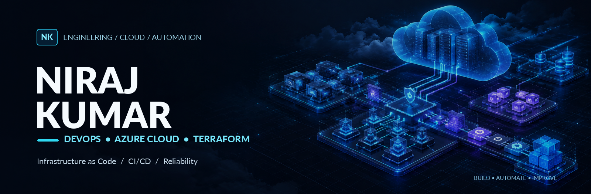
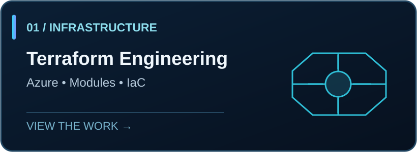
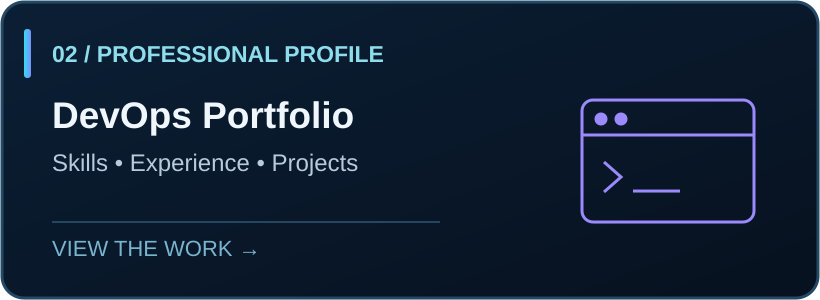
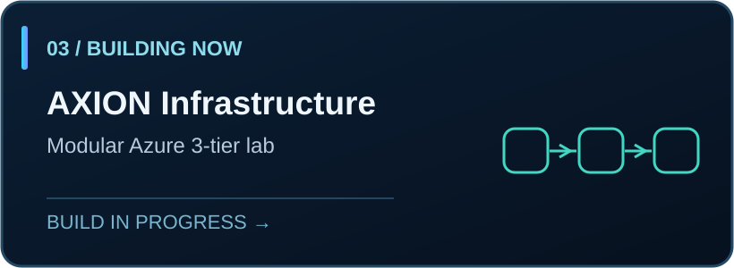
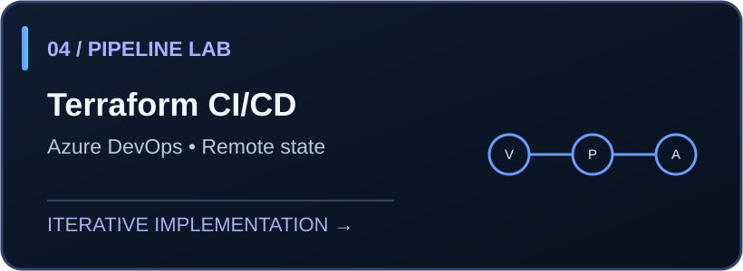
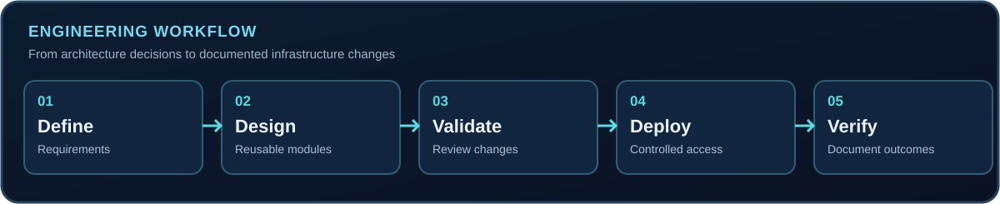

 

**CLOUD INFRASTRUCTURE** &nbsp; / &nbsp; **AUTOMATION** &nbsp; / &nbsp; **RELIABILITY**

9+ years in IT operations and reliability engineering. Building hands-on expertise in Azure infrastructure, Terraform, and CI/CD.

[**Portfolio ↗**](https://nirajkumardev.vercel.app/) &nbsp;&nbsp;·&nbsp;&nbsp; [**Explore repositories ↗**](https://github.com/Niraj128?tab=repositories)

---

### `01 / WHO I AM`

I work at the intersection of **systems reliability, infrastructure, and automation**. My experience includes production-facing technical operations and troubleshooting; my current engineering focus is designing and documenting Azure infrastructure through practical projects.

I value **clear architecture, repeatable deployments, sensible security boundaries, and documentation that another engineer can follow**.

### `02 / MY ENGINEERING TOOLKIT`

| Area | Tools and concepts |
| :--- | :--- |
| **Cloud** | Microsoft Azure · resource groups · VNets · subnets · NSGs |
| **Infrastructure as Code** | Terraform · reusable modules · variables · remote state |
| **Pipelines and version control** | Azure DevOps · Azure Pipelines · Git · GitHub |
| **Systems and reliability** | Linux · Windows · diagnostics · monitoring · incident troubleshooting |
| **Currently exploring** | CI/CD security checks · identity-based authentication · platform engineering |

### `03 / SELECTED WORK`

<table>
<tr>
<td width="50%" valign="top">

 
<b>Terraform Engineering</b> 
Terraform code and infrastructure learning work. The repository is being organized and documented.
</td>
<td width="50%" valign="top">

 
<b>DevOps Portfolio</b> 
A separate portfolio website to explore my technical background and projects.
</td>
</tr>
</table>

### `04 / CURRENTLY BUILDING`

<table>
<tr>
<td width="50%" valign="top">

 
<b>AXION — Modular Azure Infrastructure</b> 
Hands-on Azure infrastructure lab using Terraform modules and environment-specific configurations. Features are documented as they are built and tested.
</td>
<td width="50%" valign="top">

 
<b>Azure DevOps — Terraform CI/CD Lab</b> 
Working through Terraform validation, planning, remote state, and controlled changes. This is a learning implementation, not a claim of a production platform.
</td>
</tr>
</table>

### `05 / MY ENGINEERING APPROACH`

Repeatability, traceability, and clear documentation matter as much as the infrastructure itself.

**[View my portfolio](https://nirajkumardev.vercel.app/)** · **[Browse my GitHub repositories](https://github.com/Niraj128?tab=repositories)**

